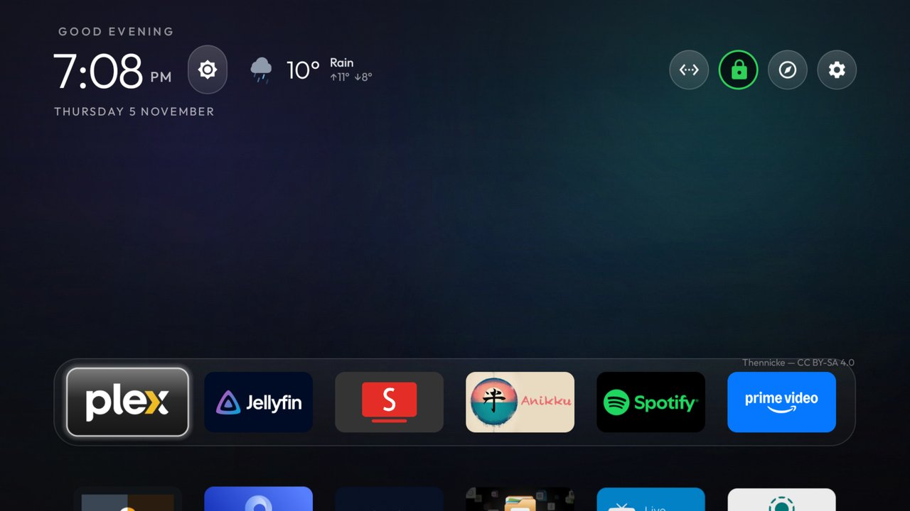

# Shield fork: remote buttons, styles, widgets and a Top Shelf

A fork of the [Clean Your TV](README.md) launcher, tuned on an NVIDIA SHIELD TV Pro (2019) at 4K,
Android TV 11. It is a heavy restyle and larger than upstream's APK size gate, so it lives here and
not in a pull request. Build it from source: `launcher/build-and-install.ps1` (or `.sh`) as in the
main README.

## What it adds

- **Remote buttons**: map any button to an app or action as press, hold or double press, set on the
  TV (`KeyMap`, `RemoteKeysActivity`, with the key helper capturing the button).
- **Style presets** ("Clean Look") that change colours, wallpaper, dock and columns together, and a
  grouped settings side panel with a popup picker per row; hold OK on a row for its tip.
- **Move mode**: pick up an app tile and move it with the D-pad.
- **A Top Shelf** above the dock: the focused app's own "continue watching" artwork when the
  Continue watching add-on is installed, otherwise a slow photo or wallpaper backdrop.
- **Widgets**: a weather chip and a brightness control that sit beside the clock or in the top bar,
  each supplied by an add-on in `addons/`. The launcher asks neither for a permission.
- **Top bar**: a red/green icon-only VPN button, a Discover pill that opens the Continue watching
  hub, and an icon, text or both style for the top-bar buttons.

## The launcher menu

The gear in the top bar opens a settings side panel. OK on a row opens a small popup picker next to it, and
holding OK on a row shows a one-line tip for what it does. Rows are in five groups:

| Group | Rows |
|---|---|
| **Home layout** | Columns (4 to 7), rows of apps under the dock (0 to 3), dock opacity (a slider), Open on start |
| **Look** | Style, Wallpaper, Clock (system, 12 or 24 hour), **Widgets**, Animations, Advanced effects |
| **Top Shelf** | Top Shelf (layered or off), App artwork, Photos, Photo themes, Fetch a new photo, Change every (10 s to 1 hour), Photo credit |
| **Buttons & remote** | Remote buttons (press, hold or double press), Top bar buttons (icons, text, both, mixed or one choice per button), Reorder apps, Edit dock |
| **System** | Default Home (switch to the TV's original Home), TV settings, Reset Theme |

- **Style** picks a Clean Look preset: the launcher's own look, Cinematic (artwork shelf, glass dock), Glass,
  Aurora, Minimal or Six columns. Applying one restarts Home and keeps your dock apps, columns, remote buttons,
  VPN button and weather settings.
- **Reset Theme** says how many changes it will clear before it does, and goes back to the theme's own settings.
- Rows that need an add-on, such as Photos, are greyed with a reason while it is missing or too old.

## Widget positions

**Look > Widgets** in the menu lists what is installed. Choosing a widget asks "Where should it go?" and offers four
places on Home:

1. Beside the clock
2. Beside weather
3. Top bar, before the buttons
4. Top bar, after the buttons

Each place says whether it is free, "now" for the current one, or "Taken by" another widget. Picking a taken place
swaps the two when the other widget can live there, and says so; when it cannot, it asks you to move or remove
it first. **Remove from Home** takes a widget off. In the screenshot above, the brightness button sits next to
the clock and the weather chip follows it.

Each widget has its own settings:

- **Weather**: unit (same as the Weather add-on, Celsius or Fahrenheit), whether to show the place on Home (off
  by default), and the city.
- **Brightness**: step size (automatic, 5% or 10%) and style (icon and level, level only, icon only). It needs
  Android's "display over other apps" permission for the Brightness add-on and says so when it is missing.

A widget whose add-on is not installed shows "Not installed" instead of failing.

## Discover

The compass button in the top bar opens the **Continue watching** hub from the optional add-on in
`addons/continue-watching`: everything you are partway through, with the title's own picture, a resume bar and the
episode and time left. OK starts the title in its app.

- **Grouped by app**: one section per app that has something to resume, with the app's icon, name, how many
  titles, and the row they came from. The app you watched most recently comes first.
- **Sources you add yourself**: a tile grid with a status dot per source and a **+ Add source** tile. Sources are
  Android TV's Watch Next rows from apps that publish them, preview channels such as Plex and Netflix, and your
  own Jellyfin server. Nothing shows until you add it; channels named like "Continue watching" start on and the
  rest start off.
- **Top Shelf feed**: the same data lets the launcher show the focused app's artwork above the dock. It has a
  switch; off, the launcher gets nothing and the cached pictures are deleted.

The add-on's README has the full list of what it reads and sends.

## Permissions and network

- **The launcher** has no `INTERNET` permission and makes no network request, as upstream. Its
  manifest differs from upstream only by `<queries>` entries for the three add-ons below and new
  internal settings screens. It adds no `uses-permission`.
- **Add-ons are optional**, each its own app, and none is built into the launcher:
  - `addons/continue-watching` (`INTERNET`, `READ_TV_LISTINGS`): your Jellyfin server, if you add
    one, the picture addresses other apps publish, and, for the Top Shelf photos,
    `commons.wikimedia.org` and `upload.wikimedia.org` only. No account or identifier is sent.
  - `addons/weather` (`INTERNET`, `RECEIVE_BOOT_COMPLETED`): `api.open-meteo.com`,
    `geocoding-api.open-meteo.com` and `air-quality-api.open-meteo.com`. The city name is shared
    with the launcher only if you turn on "Show place on Home" (off by default).
  - `addons/brightness` (`SYSTEM_ALERT_WINDOW`, `FOREGROUND_SERVICE`, `RECEIVE_BOOT_COMPLETED`):
    no network.
- Nothing is collected beyond the above. The key helper is an accessibility service that stays off
  until you turn it on, and reads only the buttons you mapped.

## Defaults

The defaults in `config.xml` are upstream's. Everything above is chosen on the TV or by a theme.

## Tested on

NVIDIA SHIELD TV Pro (2019), Android TV 11, SHIELD Experience 9.2.4. Not tested on other TVs.
Launcher unit tests and `lintRelease` pass; the release APK is about 1 MB.
